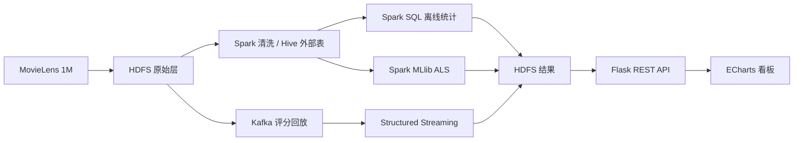

# MovieLens 电影评分分析与推荐

使用 Hadoop、Hive、Spark 和 Kafka 处理 MovieLens 1M，以 Flask API 和 ECharts 看板展示离线统计、历史评分回放、低分告警和个性化推荐。

**已有可用集群**可先[克隆仓库](#2-克隆仓库)，再[启动看板](#4-在宿主机启动看板)。**从零复现**请先准备三台虚拟机，再按下方步骤生成 HDFS 结果。

## 环境要求

| 运行位置 | 依赖 |
| --- | --- |
| NameNode 与两台 DataNode | Linux、JDK 8、Hadoop 3.2.0、可用的 HDFS 和 YARN。使用 VMware 时，三台虚拟机需在同一 NAT 网络 |
| NameNode | Spark 3.1.2（Scala 2.12）、Hive 3.1.2、Kafka 3.9.2。复现脚本需要 Bash |
| 看板宿主机 | Python 3.11、Git、浏览器。可以访问 NameNode 的 WebHDFS 和 DataNode 的 HTTP 端口 |

## 启动项目

第一次复现按 **准备三台 VM → 生成数据和结果 → 启动看板** 的顺序执行。已有项目集群和 HDFS 结果时，可确认三台 VM 已启动后直接进入 [第 4 步](#4-在宿主机启动看板)。

**拿到前一位同学已清洗的三节点磁盘时，可以跳过数据下载和清洗。** 先看 [三台 VM 配置和从清洗层继续运行的方法](infra/vmware/README.md#使用已清洗数据继续运行)。

### 1. 准备三台 VMware 虚拟机

在 VMware Workstation 启动或创建 `namenode`、`datanode1`、`datanode2`，三台连接到同一个 NAT 网络。首次配置按 [VMware 三节点复现指南](docs/vmware.md) 设置主机名、IP、SSH 和 Hadoop，初始化 Hive。使用已有课程镜像的同学也可以按指南导入。

**三台 VM 的配置文件** [NameNode](infra/vmware/namenode/hadoop.vmx) · [DataNode 1](infra/vmware/datanode1/datanode1.vmx) · [DataNode 2](infra/vmware/datanode2/datanode2.vmx)。每个 `.vmx` 要和对应节点的虚拟磁盘及全部分片放在同一目录。已有完整镜像时可直接用镜像的 `.vmx`。 [磁盘对应表和导入步骤](infra/vmware/README.md)

在 **NameNode** 上运行以下命令。若 Hadoop 安装位置不同，先把 `HADOOP_HOME` 改为实际路径。

```bash
export HADOOP_HOME="${HADOOP_HOME:-$HOME/hadoop-3.2.0}"
"$HADOOP_HOME/bin/hdfs" dfsadmin -report
"$HADOOP_HOME/bin/yarn" node -list
```

看到 **2 个在线 DataNode、2 个 RUNNING 的 NodeManager** 后，再开始生成项目数据。

### 2. 克隆仓库

在 **NameNode 虚拟机**保留一份仓库，用来执行数据流水线。在 **Windows 宿主机**也克隆一份，用来启动看板。若配置虚拟机时已克隆，直接进入已有目录即可。

```bash
git clone https://github.com/AAaawwee/movielens-bigdata-dashboard-1.git
cd movielens-bigdata-dashboard-1
```

### 3. 在 NameNode 生成数据和结果

已导入带原始数据和清洗结果的课程镜像时，在 NameNode 的仓库目录运行下列命令，从清洗结果继续。

```bash
bash scripts/resume-from-clean.sh --check
bash scripts/resume-from-clean.sh --run
```

从空集群安装时走完整流程。

从 [GroupLens](https://grouplens.org/datasets/movielens/1m/) 下载并解压 MovieLens 1M，在 **NameNode 的仓库目录**按 [部署与复现命令](docs/deployment.md#在集群上生成数据与结果) 依次执行 **HDFS 入湖 → Spark 清洗 → Hive 建表 → 离线 SQL → ALS 训练及推荐 → Kafka 回放 → Streaming**。

运行完成后，用下面的命令确认看板需要的结果已生成。

```bash
"$HADOOP_HOME/bin/hdfs" dfs -ls /movie/result/offline /movie/result/recommendations
"$HADOOP_HOME/bin/hdfs" dfs -ls /movie/result/realtime/latest.json
```

### 4. 在宿主机启动看板

在 **Windows PowerShell** 进入宿主机上克隆的仓库目录。安装 Python 3.11 后执行以下命令，先将三个 `<…-IP>` 占位符换成虚拟机的实际 NAT IPv4 地址。可在各虚拟机运行 `ip -4 -o addr show scope global` 查看。

```powershell
py -3.11 -m venv .venv
& .\.venv\Scripts\python.exe -m pip install -r dashboard/requirements.txt

$env:MOVIELENS_WEBHDFS = 'http://<NameNode-IP>:9870/webhdfs/v1'
$env:MOVIELENS_DATANODES = '{"datanode1":"<DataNode1-IP>","datanode2":"<DataNode2-IP>"}'
$env:MOVIELENS_KAFKA_BOOTSTRAP = '<NameNode-IP>:9092'
& .\.venv\Scripts\python.exe dashboard/app.py --port 5066
```

终端显示 `Running on http://127.0.0.1:5066` 后，在**运行 Flask 的电脑**上用浏览器打开 `http://127.0.0.1:5066/`。总览应显示 **1,000,209 条评分**，页面应显示 **10 张图表**，查询用户 `1` 应返回 **10 条推荐**。如果页面能打开但读不到数据，先检查宿主机到 NameNode 的 `9870` 端口和两台 DataNode 的 `9864` 端口是否可达。

<details>
<summary>使用 Linux 启动看板</summary>

```bash
python3.11 -m venv .venv
.venv/bin/python -m pip install -r dashboard/requirements.txt
export MOVIELENS_WEBHDFS='http://<NameNode-IP>:9870/webhdfs/v1'
export MOVIELENS_DATANODES='{"datanode1":"<DataNode1-IP>","datanode2":"<DataNode2-IP>"}'
export MOVIELENS_KAFKA_BOOTSTRAP='<NameNode-IP>:9092'
.venv/bin/python dashboard/app.py --port 5066
```

</details>

### 常见启动问题

| 现象 | 检查项 |
| --- | --- |
| Windows 找不到 `py -3.11` | 安装 Python 3.11 后重新打开 PowerShell。用 `py -0p` 检查已安装版本 |
| 看板能打开，统计和推荐接口返回 503 | 确认 WebHDFS 已启用、`MOVIELENS_DATANODES` 包含两个 DataNode，以及第 3 步的 HDFS 产物存在 |
| 显示 Kafka 不可达，但仍有图和告警 | 看板正在使用最近快照。检查 Kafka 端口及广播地址，详见[部署与复现](docs/deployment.md) |

## 看板预览


## 功能

- **数据入湖**。原始评分、电影和用户数据写入 HDFS，经清洗后存为 Parquet，注册六张 Hive 外部表。
- **离线分析**。Spark SQL 统计影片、类型、用户、日期、小时和星级分布。看板包括月度评分趋势、每日活跃用户、影片热度与口碑散点图，以及可按年和季度切换的日历热力图。
- **ALS 推荐**。在 YARN 上训练并保存模型，为已有用户生成未评分影片 Top 10，可加载已有模型进行查询。
- **流式分析**。Kafka 按事件时间回放历史评分，Spark Structured Streaming 生成五分钟窗口，用 checkpoint 从中断处恢复，通过 `foreachBatch` 写入结果。Flask 每 5 秒响应页面轮询，在 Kafka 断开时继续显示最近快照。



## 目录

| 路径 | 用途 |
| --- | --- |
| [dashboard/](dashboard/) | Flask 应用、前端模板和 ECharts |
| [pipeline/ingest/](pipeline/ingest/) | HDFS 入湖及 Spark 清洗 |
| [pipeline/sql/](pipeline/sql/) | Hive 六表 DDL |
| [pipeline/offline/](pipeline/offline/) | Spark SQL 离线统计 |
| [pipeline/als/](pipeline/als/) | Scala ALS 作业及 PySpark 版本 |
| [pipeline/streaming/](pipeline/streaming/) | Kafka 回放和 Structured Streaming |
| [infra/hadoop/](infra/hadoop/) | 三节点 Hadoop 配置模板 |
| [infra/vmware/](infra/vmware/) | 三台 VMware 的 `.vmx` 和磁盘对应表 |
| [verification/](verification/) | Hive、Kafka、页面回归核验 |
| [docs/](docs/) | 复现说明、验收结果和页面截图 |

## 接口

| GET 路径 | 返回数据 |
| --- | --- |
| `/api/overview` | 评分、影片、用户数 |
| `/api/offline/trend` | 月度趋势、平均分、每日评分量和活跃用户、评分分布与类型 |
| `/api/offline/hourly` | UTC 逐小时评分量 |
| `/api/offline/movie-scores` | 有至少 50 条评分的影片评分量和平均分 |
| `/api/movie/ranking` | 热门影片排行 |
| `/api/recommendations?user_id=1` | 指定用户的 ALS 推荐 |
| `/api/realtime` | 五分钟窗口、数据来源和连接状态 |
| `/api/alerts` | 最近快照的中、高度低分告警 |

## 验收结果

| 项目 | 项目原集群统计 |
| --- | --- |
| 数据量 | 1,000,209 条评分、3,883 部影片、6,040 位用户 |
| ALS | 60,400 条推荐。RMSE 0.8923，MAE 0.7097，测试评分覆盖率 52.19% |
| 流式分析 | 55,841 个有评分的五分钟窗口，原回放峰值约 15,409 条/秒 |
| 看板 | 8 个 API、10 个图表区。测试断开 Kafka 后仍显示最近 30 个有评分窗口 |

完整口径见 [验收记录](docs/verification.md)。

## 数据和来源

从 [GroupLens MovieLens 1M](https://grouplens.org/datasets/movielens/1m/) 获取原始数据，遵守 [数据使用许可](https://files.grouplens.org/datasets/movielens/ml-1m-README.txt)。仓库提供代码、示意截图和汇总指标，数据、模型和流式产物由流水线生成。

此课程项目的技术路线参考 [Distributed Spark Movie Recommender](https://github.com/zubiiabbasi/distributed-spark-movielens-recommender)。随项目分发的 Apache ECharts 保留原 [LICENSE](dashboard/static/echarts-LICENSE.txt) 和 [NOTICE](dashboard/static/echarts-NOTICE.txt)。
